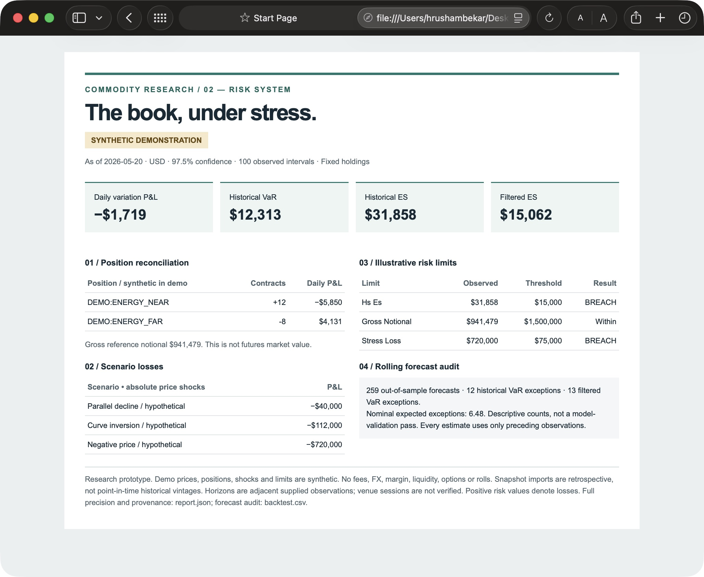

# Commodity Risk System

### Know what the book loses—and why.

A reproducible research system for a small futures and calendar-spread book.
It turns explicit contract holdings into reconciled variation P&L, historical and
filtered risk estimates, scenario losses and an auditable rolling backtest.
This is **Project 2** in the commodity research portfolio.

**Working local prototype · Synthetic demonstration · USD futures only**



## Run the demonstration

Requires [uv](https://docs.astral.sh/uv/). The reproducible environment pins Python 3.11;
uv installs it when needed.

```sh
uv sync --locked --extra dev
uv run commodity-risk demo
open output/demo/report.html  # macOS; elsewhere open this file in a browser
uv run pytest -q
uv run ruff check .
uv run mypy src
```

No credentials, downloads or sibling repository are required for the demo.
The HTML brief is self-contained, responsive and has an A4 landscape print layout.
The same command exports full-precision JSON, a forecast-by-forecast CSV audit,
and the exact input holdings and quotes.

## Verified demonstration

Seed `20261009`; 360 synthetic weekday observations; 100-observation rolling window;
97.5% confidence; hypothetical holdings of +12 near and −8 far contracts, each with
an assumed 1,000-barrel multiplier. **These are not observed market results.**

| Measure | Reproduced result |
| :--- | ---: |
| Latest variation P&L | −$1,719.11 |
| Historical VaR / ES | $12,313.13 / $31,857.58 |
| Filtered VaR / ES | $11,766.25 / $15,062.33 |
| Out-of-sample forecasts | 259 |
| Historical / filtered VaR exceptions | 12 / 13 |
| Illustrative limits breached | 2 of 3 |

The shock generator contains an explicitly injected curve shock. Results demonstrate
accounting and risk mechanics, not model calibration or trading performance.
Compare [the saved result](examples/demo-report.json) and
[research note](docs/RESEARCH.md). Local numerical and input-validation tests are
included; the CI configuration is not evidence of a hosted run.

## Bring a platform snapshot

The importer consumes the versioned Parquet schema from `commodity-data-platform`.
It requires individual daily futures contracts, contract metadata, compatible units,
complete synchronized prices and source lineage. Spot, monthly and rank proxies are
rejected. Daily closes retain their `futures_contract_close` label; they are not
promoted to official settlements.

```sh
uv run commodity-risk run --snapshot /path/to/platform-snapshot.parquet \
  --book /path/to/book.csv --scenarios /path/to/scenarios.json \
  --limits /path/to/limits.json --window 100 --output output/research
```

See [input contracts and methodology](docs/METHODOLOGY.md) for schemas, conventions,
validation and limitations. The current platform's one dated WTI contract cannot
validate a two-contract spread or a roll. Import is tested with a schema-compatible
fixture; live end-to-end settlement validation remains outstanding.

## Scope and next gates

Implemented: contract-level P&L, joint historical shocks, empirical VaR/ES,
EWMA filtered simulation, hypothetical stresses, worst observed shock replay,
rolling exception counts, configurable limits, source hashes and an HTML risk brief.

Before live daily use: supply authorized settlement histories, verify venue sessions
and quote freshness, add dated position changes and expiry/first-notice roll handling,
and validate against an independent risk system. Historical imports use one current
snapshot, so historical data availability and revisions are not reconstructed.

No options, liquidity or margin estimates, fees, currency conversion, investment
recommendations or regulatory-capital claims. PDF export, an interactive dashboard,
formal backtest diagnostics and real historical event libraries remain later work.

[Methodology & architecture](docs/METHODOLOGY.md) · [Research note](docs/RESEARCH.md)
